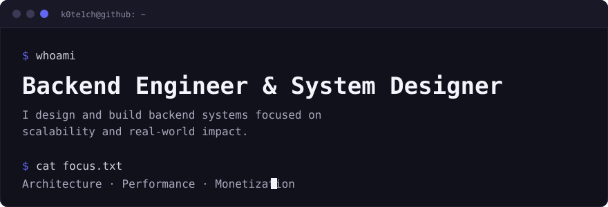

<div align="center">



</div>

## 01 · About

```text
$ cat about.txt
→ shipping code on GitHub since 2019, 20+ public repositories
→ PodBoxBot: a Telegram bot with 200+ commits and 12 releases
→ native C++ tools: powerpeek is one 4 MB exe, no installer, no telemetry
→ I take a product from idea to a working release: architecture, backend, bot
```

## 02 · Stack

<div align="center">


</div>

## 03 · Projects

| Project | What it is | Activity |
|---|---|---|
| [**PodBoxBot**](https://github.com/k0te1ch/PodBoxBot) | Telegram bot (Python) |   |
| [**Timetable-bot**](https://github.com/k0te1ch/Timetable-bot) | Class schedule and notifications for VSU students (Python) |  |
| [**powerpeek**](https://github.com/k0te1ch/powerpeek) | Device battery in the Windows tray: live icon, notifications, charge history (C++) |  |
| [**DialogEngine**](https://github.com/k0te1ch/DialogEngine) | Lightweight dialog engine for form-driven Telegram bots (Python) |  |

## 04 · Engineering focus

```text
→ backend architecture & APIs
→ performance & optimization (C++ / Python)
→ system design & scalability
→ building monetizable products
```

<div align="center">

[](https://t.me/k0te1ch)
[](https://vk.com/k0te1ch)

<br>

<sub>build → validate → scale → monetize</sub>

</div>
