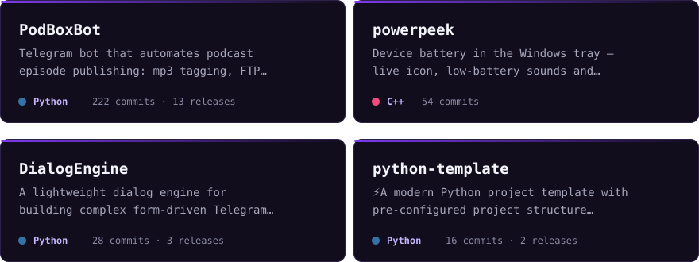
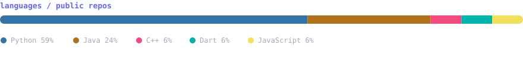
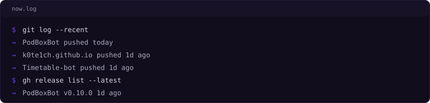
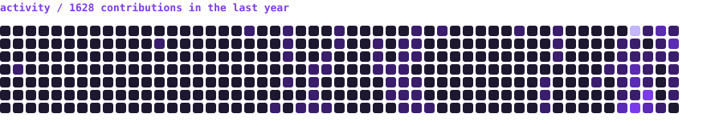

<div align="center">

<picture>
  <source media="(prefers-color-scheme: light)" srcset="assets/banner-light.svg">
  
</picture>

</div>

## 01 · About

```text
$ cat about.txt
→ shipping code on GitHub since 2019, 20+ public repositories
→ PodBoxBot: Kafka microservices that publish podcast episodes for a real team, 12 releases, Grafana dashboards
→ native C++ tools: powerpeek is one 4 MB exe, no installer, no telemetry
→ I take a product from idea to a working release: architecture, backend, bot
```

## 02 · Stack

<div align="center">


</div>

## 03 · Projects

<div align="center">

<picture>
  <source media="(prefers-color-scheme: light)" srcset="assets/projects-light.svg">
  
</picture>

<sub>
<a href="https://github.com/k0te1ch/PodBoxBot">PodBoxBot</a> ·
<a href="https://github.com/k0te1ch/Timetable-bot">Timetable-bot</a> ·
<a href="https://github.com/k0te1ch/powerpeek">powerpeek</a> ·
<a href="https://github.com/k0te1ch/DialogEngine">DialogEngine</a>
</sub>

<br><br>

<picture>
  <source media="(prefers-color-scheme: light)" srcset="assets/languages-light.svg">
  
</picture>

</div>

## 04 · Now

<div align="center">

<picture>
  <source media="(prefers-color-scheme: light)" srcset="assets/now-light.svg">
  
</picture>

<br>

<picture>
  <source media="(prefers-color-scheme: light)" srcset="assets/activity-light.svg">
  
</picture>

</div>

## 05 · Engineering focus

```text
→ backend architecture & APIs
→ performance & optimization (C++ / Python)
→ system design & scalability
→ building monetizable products
```

<div align="center">

[](https://t.me/k0te1ch)
[](https://vk.com/k0te1ch)
[](https://k0te1ch.github.io)

<br>

<sub>build → validate → scale → monetize</sub>

</div>
